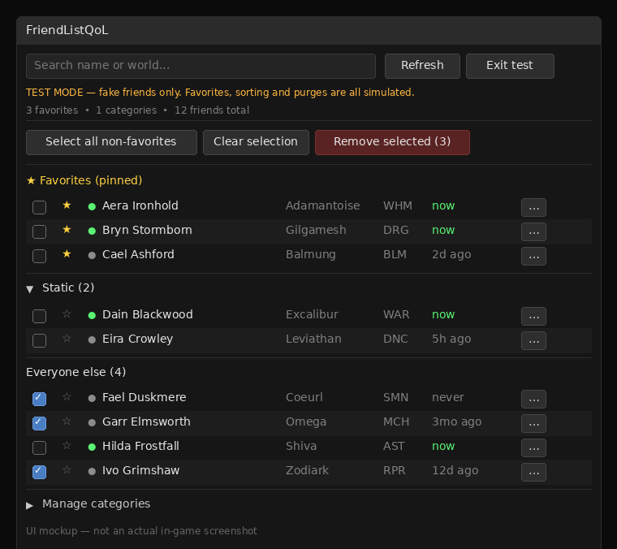

# FriendListQoL


*UI mockup — actual in-game appearance may vary slightly.*

A Dalamud plugin for FFXIV that fixes the two most annoying things about the
friend list:

1. **Favorites** — star anyone and they stay pinned in a section at the top of
   the list, always visible no matter how the rest is sorted. You can also
   right-click anyone in the game's own Friend List window and hit ★ Favorite.
2. **Purge** — check off (or select all) non-favorited friends and remove them
   in one go, with a confirmation, progress bar, cancel button, and a
   configurable delay between removals. Favorites can never be purged.
3. **Custom categories** — group friends (e.g. "static", "crafters") into
   collapsible sections with a ▼/▶ toggle. Use the … button on any row.
4. **Last seen** — the game doesn't expose last-online, so the plugin tracks
   it itself from the moment it's installed and shows it per friend — handy
   context when deciding who to purge.

Open it in-game with `/flqol`. Settings with `/flqol config`.

## Status

- Friend reading, favorites, and the full purge pipeline (queue, pacing,
  confirmation handling, progress UI) are implemented.
- **One step needs in-game calibration**: the exact game calls that drive
  "remove friend" on a friend-list row. See "Calibrating removal" below.
  Until that's filled in, a real purge refuses to run blind (by design) —
  but **test mode** lets you exercise everything safely (see below).
- Nothing here has been compile-tested yet — build it on your Windows machine
  and fix whatever the compiler complains about first.

## Test mode

`/flqol test` (or the "Test mode" button in the window) swaps in 60 fake
friends with a fixed seed, so the same set appears every time. Favorites,
search, sorting, selection, and the entire purge flow — including the
confirmation step, pacing delay, progress bar, and cancel — all run against
the fakes. Simulated removals delete entries from the fake list so you can
watch it shrink. Nothing touches your real friend list, and test mode is
never saved: it's always off when the plugin loads.

## Build

You need Windows and the .NET SDK (9 or newer).

```powershell
cd FriendListQoL
dotnet build -c Release
```

The first build downloads the Dalamud libraries automatically
(`Dalamud.NET.Sdk` handles it). Output lands in
`bin/Release/net9.0-windows/` (framework version depends on the SDK).

### Load it as a dev plugin

1. In-game: `/xlsettings` → **Experimental** → **Dev Plugin Locations** → add
   the build output folder.
2. Restart the game (or `/xlplugins` → rescan). It appears as **FriendListQoL**.
3. `/flqol` to open.

## Publishing as a custom Dalamud repo

Dalamud's **Custom Plugin Repositories** field (in `/xlsettings` →
**Experimental**) needs a direct link to a **repo JSON file** — not a
`github.com/...git` URL, which is a git clone endpoint and won't work.
The JSON lists your plugins and where to download their zips.

Steps:

1. Push this project to a **public** GitHub repo. (Private repos can't work
   here — Dalamud fetches the JSON with no login, so private raw URLs fail.
   Keep the code private and share the zip manually if you prefer; see below.)
2. In `repo.json`, replace `YOURNAME`/`YOURREPO` with your repo path, and
   make sure `AssemblyVersion` matches the `<Version>` in the `.csproj`.
3. Commit and push a version tag: `git tag v1.0.0 && git push origin v1.0.0`.
   The `release.yml` workflow builds the plugin and attaches
   `FriendListQoL.zip` to a GitHub Release.
4. In Dalamud settings → **Experimental** → **Custom Plugin Repositories**,
   paste:
   `https://raw.githubusercontent.com/YOURNAME/YOURREPO/main/repo.json`
   then open `/xlplugins` — FriendListQoL appears and installs like any
   other plugin, with updates handled automatically.

Prefer to stay private? Skip the custom repo: add friends as collaborators,
have them download `FriendListQoL.zip` from the Actions/Release artifacts,
and load it as a dev plugin (steps above).

## How it works

- **Reading friends** (`Services/FriendCache.cs`): hooks
  `InfoProxyCommonList.EndRequest` on the game's `InfoProxyFriendList` — the
  same data source the native Friend List window uses — and rebuilds the list
  whenever the game finishes a friend-data request. Same technique as the
  [BetterFriendList](https://github.com/devckuw/BetterFriendList) plugin.
- **Favorites** (`Configuration.cs`): stored as a set of friend **ContentIds**,
  which are stable across name changes, world transfers, and data-center
  visits. The UI renders favorites in a pinned section above everyone else.
  `NativeFavoriteMenu.cs` also injects a ★ Favorite entry into the game's own
  Friend List right-click menu via Dalamud's `IContextMenu` API.
- **Last seen** (`Services/FriendCache.cs`): every friend-list refresh stamps
  the current time for friends who are online. The game offers no last-online
  data (the timestamp array in the structs is undocumented), so this history
  only goes back as far as the plugin has been installed. Saved at most once
  a minute, plus once on unload.
- **Purge** (`Removal/FriendRemover.cs`): a small state machine stepped on
  `IFramework.Update` —
  `Triggering → WaitingForConfirm → CoolingDown → next`.
  It filters favorites out defensively, waits for the game's own Yes/No dialog,
  clicks Yes, then waits out the configured delay before the next friend.

## Calibrating removal

Manually, removing a friend is: open the game's Friend List → right-click a
row → context menu → the remove entry → confirm dialog. Nobody has publicly
mapped the exact callbacks the game fires for this, so `TriggerGameRemove()`
in `Removal/FriendRemover.cs` is the one method left to finish:

1. Write a tiny scratch plugin that hooks `AtkUnitBase.FireCallback` and logs
   `(addon name, callback id, values)`.
2. Manually remove one friend via the game's Friend List and note the callback
   id + values fired for row selection and for the context-menu remove choice.
3. Replay those calls in `TriggerGameRemove()` for the target's row and delete
   the early-return guard.
4. Do the same check for `ClickYes()` — it assumes callback value `0` means
   "Yes" on the `SelectYesno` dialog. If that misbehaves, use
   [ClickLib](https://github.com/chirpxiv/ClickLib)'s `ClickSelectYesno`
   instead.

Test with **one** friend first (select a single non-favorite), watch the log,
then run the full purge.

## Design notes / safety

- Favorites are excluded from purge selection in the UI **and** filtered again
  inside `FriendRemover.Start()` — two layers, so a UI bug can't nuke a
  favorite.
- Removals go through the game's own flow (context menu + confirm dialog),
  one at a time, with a default 1.5s gap — the same actions you'd do by hand,
  just without the clicking.
- The purge needs the game's Friend List window open; it tells you if it isn't.
- If anything unexpected happens mid-purge (no confirm dialog, trigger
  failure), the queue stops and reports exactly where, instead of guessing.

## Ideas for later

- Right-click a friend in the *game's* list to favorite them (context-menu
  injection via `IContextMenu`).
- "Remove all offline non-favorites" one-click preset.
- Per-friend notes (like the existing FriendNote plugin).
- Submit to the official Dalamud repo once it's stable — note their rule about
  not hammering servers; the pacing delay is there for that reason.
